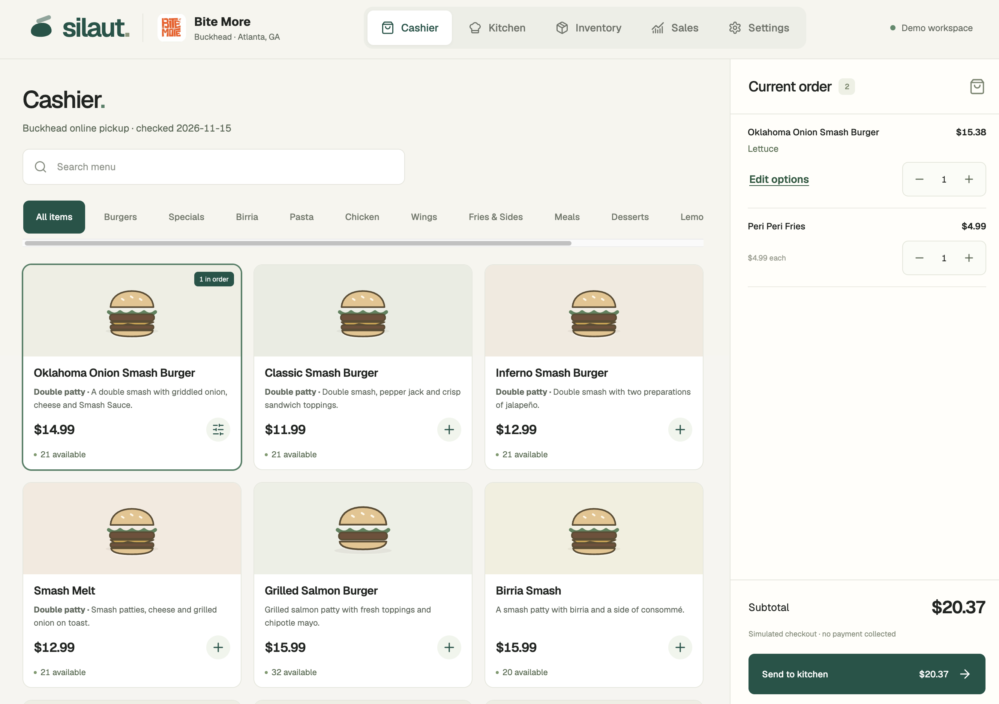
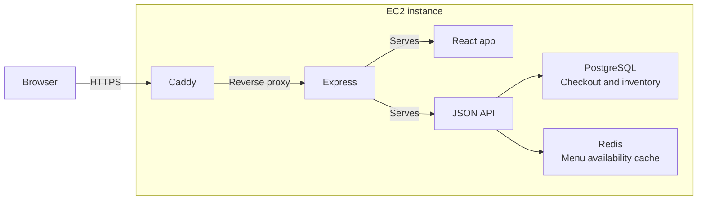

# Silaut — Restaurant POS & Inventory System

Silaut is a restaurant point-of-sale and inventory system that connects cashier orders, kitchen stations, ingredient stock, and shift reporting. Bite More Buckhead is the sample workspace. Checkout is simulated.

**Video demo:** [Watch the 90-second demo](YOUR_YOUTUBE_VIDEO_URL)

**Live demo:** [https://silaut.com/cashier](https://silaut.com/cashier) (login required).



<sub>Signed-in cashier with a $22.97 demo cart.</sub>



## Verification

- **Automated tests.** The isolated local PostgreSQL and Redis run passed 22 tests, covering normalization, checkout, concurrency, station transitions, stock movements, and shift reporting. The original API compatibility checks and the k6 smoke test ran in separate projects.
- **EC2 rehearsal and cutover.** A $22.97 Grill and Fryer order returned an identical receipt on retry and posted one set of inventory deductions. The rehearsal and live upgrade both preserved existing receipts and stock. Production HTTPS and login were verified after the cutover. [Verification summary](docs/VERIFICATION.md)

## Local quick start

Install Docker with Compose v2, then run these commands from the project root.

```bash
bash scripts/configure.sh
bash scripts/deploy.sh
```

Create your own local login when prompted. Certificate contact email is optional for local use. Open [localhost:8080/cashier](http://127.0.0.1:8080/cashier) and sign in with that login. The demo seeds 46 menu items and sample inventory. The shared demo login covers Cashier, Kitchen, Inventory, Sales, Settings, and their APIs.

```bash
# Stop the local stack and keep its data
bash scripts/compose.sh down
```

## Test commands

```bash
# Node.js 22.12+ and npm
npm ci
npm run build
npm test
npm run menu:import -- --check

# Docker Compose v2 with !reset support
bash scripts/verify-ec2.sh

# Optional browser acceptance in a disposable loopback workspace
npx playwright install chromium
bash scripts/verify-browser.sh
```

The Docker verifier runs the original API baseline, the compatibility benchmark, and the integration tests in separate database projects. The browser checklist describes the same workflow for manual testing. [Browser checks](docs/BROWSER_CHECKS.md) · [Research fixtures](research/restaurant-pos-research/README.md)

## Checkout and kitchen workflow

- **Checkout.** The server canonicalizes the cart, validates modifiers, totals ingredient requirements, and locks affected PostgreSQL rows in a consistent order. One transaction stores the receipt and station work, deducts stock, and appends ledger entries. A retry with the same UUID and cart returns the stored receipt. Redis caches availability for the item endpoint.
- **Kitchen.** One order can route to several stations. Each station advances through New, Preparing, and Ready. The order becomes Ready when its last station finishes. The cashier and kitchen share the same order number.
- **Inventory and sales.** Staff can receive stock, record waste, and reconcile counts. Sales and shift reports use committed demo orders and snapshot sample food costs. [Architecture and API notes](docs/ARCHITECTURE.md) · [Menu source and sample data](docs/MENU_IMPORT.md)

## Deployment

**Deployed version:** `v2.0.0`. The EC2 guide covers new setup, HTTPS, PostgreSQL backups, rehearsal, image promotion, and rollback. [EC2 deployment guide](docs/AWS_DEPLOYMENT.md)
